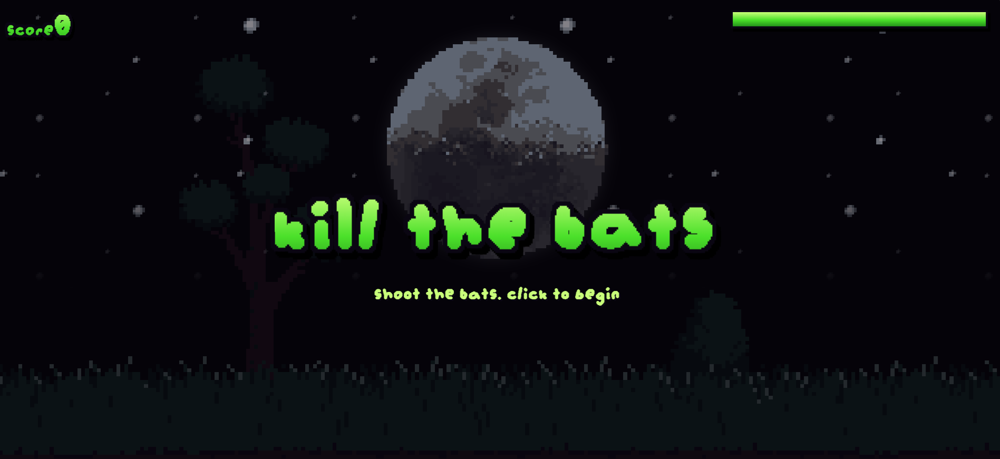
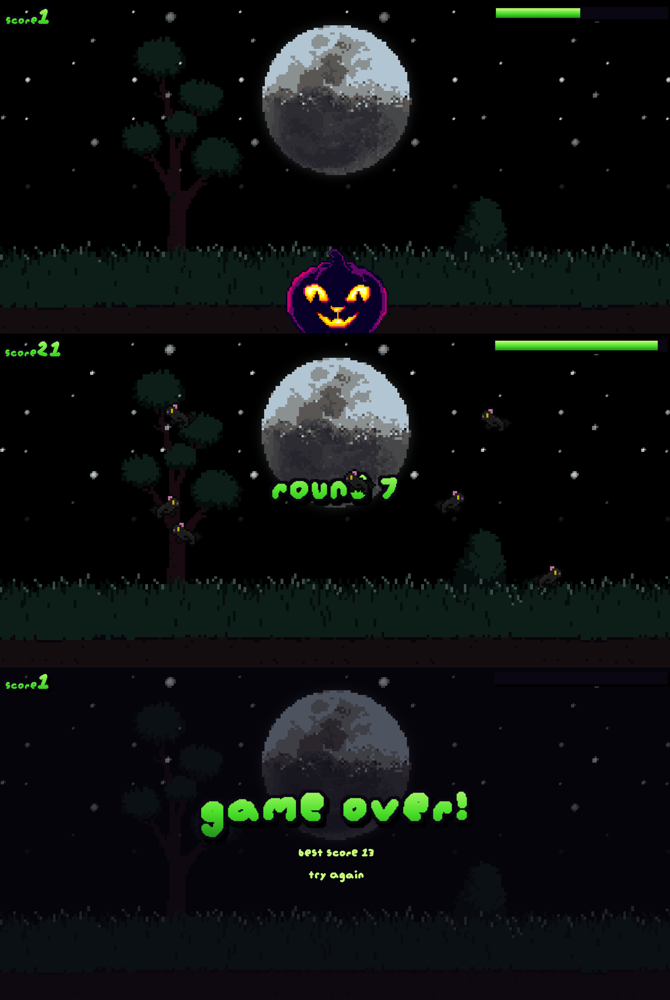

# KILL THE BATS
Shooting game where you have to kill all the bats that you see, each and every wave of them.

## WHAT IS THIS?
Its a game where you are outside in a scary night and there are a lot of dangerous bats, you have to kill them to save yourself, they r flying all over the place and with each round more bats appear, so you have to survive!! 

## HOW WAS THIS MADE?
i wanted a simple looking game while it also taught me alot of things specially the vigenette it was made using canvas, i also added sound using web audio, the notes comes from midi numbers using f = 440 * 2^((n - 69) / 12). the start sound is an A minor scale going up, kill sound and restart is a short beep and gameover is just the scale going down.

## TOOLS AND TECH USED
- This game was made in HTML/CSS and JS
- Used canvas for the vigenette effect
- The audio was made using webaudio
- Game art is used from opengameart.org

## HOW TO PLAY
- Open the demo link [click here](https://okdrinkwater1.github.io/Kill-the-bats/)
- Click the screen to start the game.
- Click on the bats to shoot them down, each bat is worth 1 point.
- Kill every bat before the timer runs out
- Next round starts with more bats + they get faster.
- If the time runs out you are greeted with a game over page. you can press the try again button to play again.

## FURTHER UPDATES?
I might add some stuffs in future:
- Better round system
- Improvised bat movements
- More art 
- Better soundtrack for the game, instead of just basic sounds.

## CREDITS
- The font is by Augie(org of jamegam)
- The pumpkins are made by Nightspore
- Cool flying bats is made by Bont
- Moon is made by Grinnch
- Stars are made by Darrius Guerrero

## SCREENSHOTS

THANK YOU!